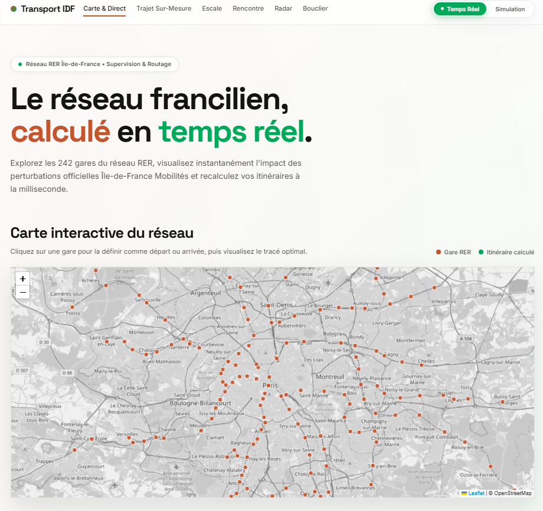
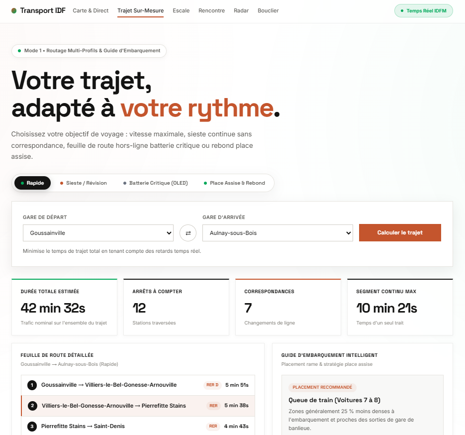
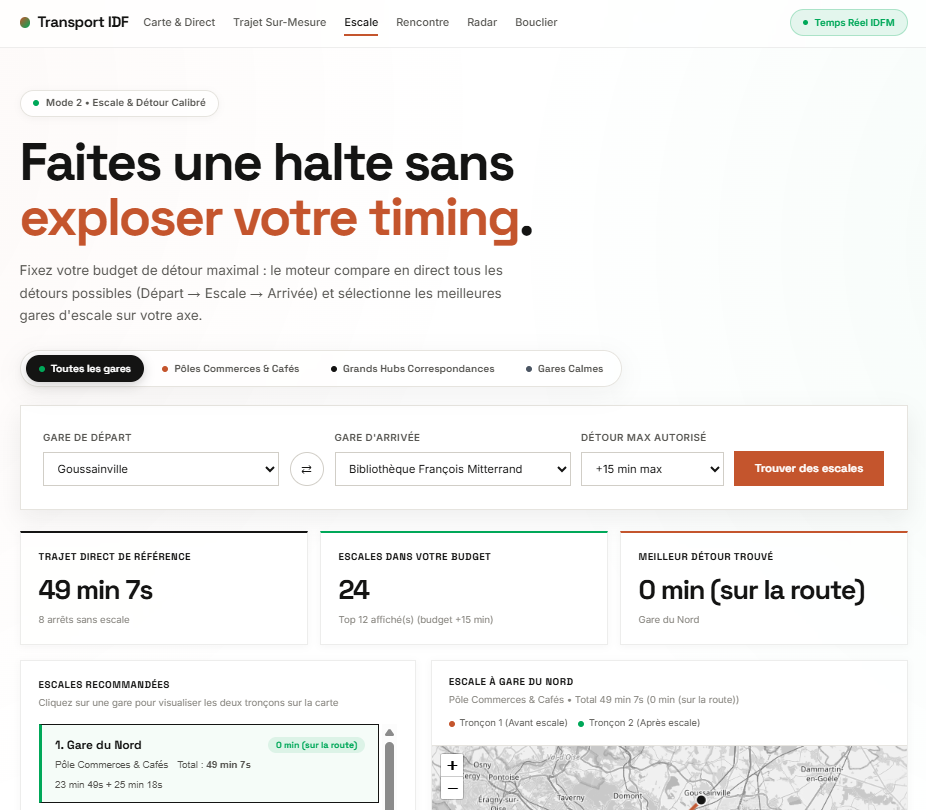
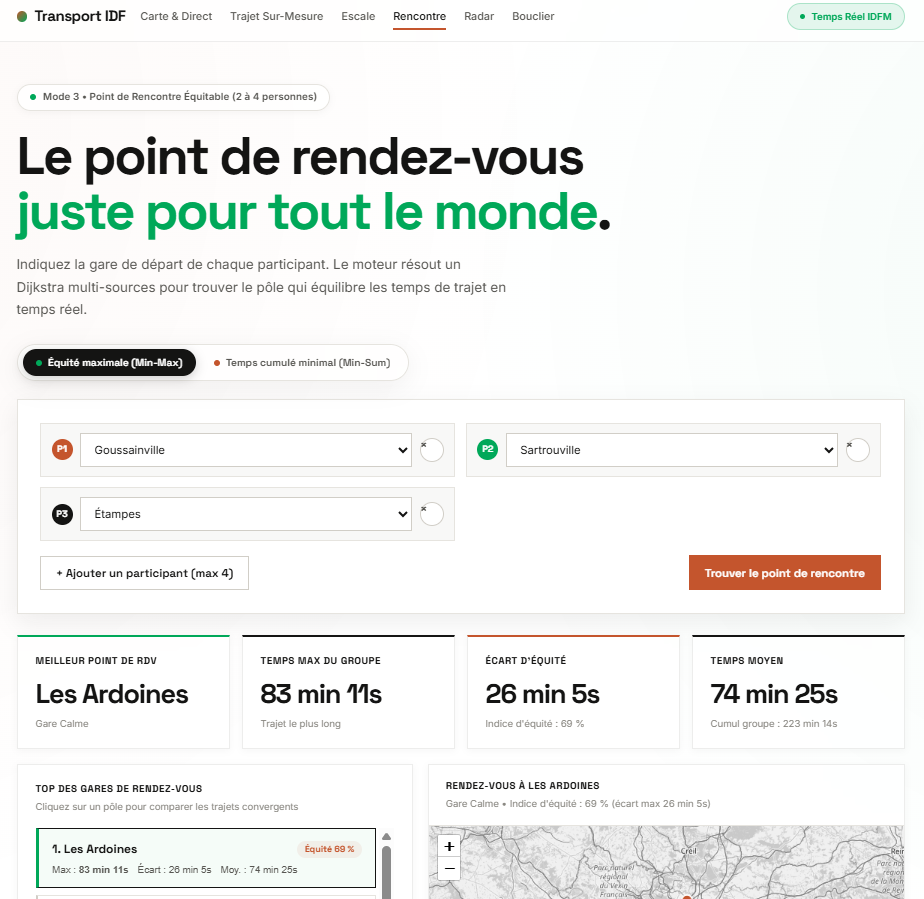
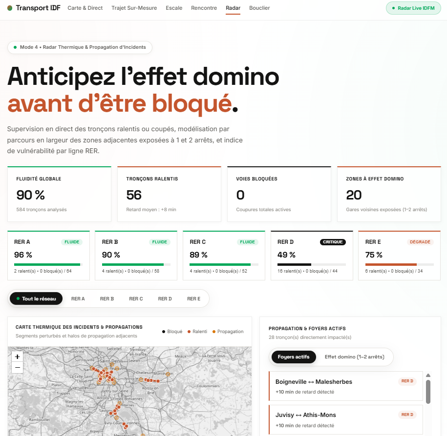
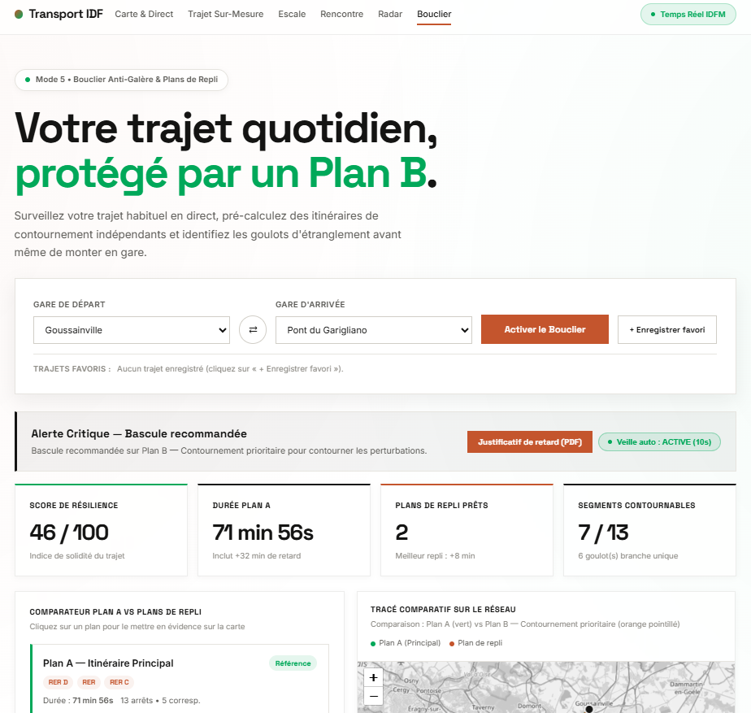

# Transport IDF — Moteur d'Itinéraires & Supervision RER Temps Réel


**Transport IDF** est une application web full-stack de calcul d'itinéraires, d'analyse prédictive et de supervision temps réel du réseau RER d'Île-de-France (lignes **RER A, B, C, D et E** — 242 gares).

Connectée au flux officiel **API PRIM d'Île-de-France Mobilités**, la plateforme associe un moteur de graphes en mémoire (**Dijkstra multi-profils, transposé et multi-sources, BFS, Haversine**) à une interface au design **Liquid Glass** (géométrie stricte, cartographie interactive Leaflet.js et analytique Chart.js).

## Démo en ligne

L'application est déployée en production et accessible directement depuis un navigateur web ou installable en tant que Progressive Web App (PWA) sur iOS et Android :

* **URL de l'application :** https://transport-idf.onrender.com

*Note : L'hébergement reposant sur une instance cloud gratuite, le premier chargement peut nécessiter environ 30 secondes si le service était en veille.*

---

## Sommaire

1. [Fonctionnalités & Modules](#fonctionnalités--modules)
2. [Architecture Technique](#architecture-technique)
3. [Ingénierie & Algorithmes de Graphes](#ingénierie--algorithmes-de-graphes)
4. [Endpoints API REST](#endpoints-api-rest)
5. [Structure du Projet](#structure-du-projet)
6. [Installation & Lancement](#installation--lancement)
7. [Architecture Cloud et Déploiement](#architecture-cloud-et-déploiement)
8. [Tests Unitaires](#tests-unitaires)


---

## Fonctionnalités & Modules

L'application s'articule autour d'un tableau de bord principal et de **5 modes métiers dédiés** :

### Socle — Carte & Direct (`index.html`)

* **Cartographie interactive Leaflet.js** des 242 gares RER avec sélection directe du départ/arrivée sur marqueur et tracé dynamique du plus court chemin.
* **Bascule Temps Réel IDFM / Simulation** : synchronisation live sur l'API PRIM Île-de-France Mobilités ou mode bac à sable pour injecter manuellement des retards et des coupures de voies.
* **Supervision Redis en direct** : visualisation des clés de perturbations actives en cache (TTL 45 secondes) et inspecteur de poids de tronçon.
* **Tableau de bord analytique (style Power BI)** : 5 tuiles KPI et 4 graphiques **Chart.js** en direct, filtrage des incidents par ligne RER (A à E) et tri alphabétique.

### Mode 1 — Trajet Sur-Mesure (`trajet.html`)

* **4 profils de routage pondérés** :
  * **Rapide (`FASTEST`)** : minimise la durée totale avec les retards temps réel.
  * **Sieste / Révision (`NAP_FOCUS`)** : applique une pénalité de $+12\text{ min}$ par correspondance pour maximiser le temps de trajet continu dans un même train.
  * **Batterie Critique (`LOW_BATTERY`)** : bascule automatique en **mode sombre OLED pur** (`#000000`), feuille de route sobre, décompte exact des arrêts et zéro appel réseau en arrière-plan.
  * **Place Assise & Rebond (`SEAT_COMFORT`)** : pénalise les tronçons perturbés et grands pôles congestionnés, avec suggestion de rebond à contre-sens.
* **Guide d'Embarquement Intelligent** : recommandation de placement dans la rame (tête, milieu ou queue) et score de confort.

### Mode 2 — Escale & Détour Calibré (`escale.html`)

* Fixation d'un **budget de détour maximal** (`+0` à `+30 min`) entre une gare de départ et une gare d'arrivée.
* Filtrage par typologie de gare : *Toutes les gares*, *Pôles Commerces & Cafés*, *Grands Hubs Correspondances* ou *Gares Calmes* (gares résidentielles de passage sans bifurcation).
* Visualisation des deux tronçons colorés (avant et après escale) sur carte Leaflet.

### Mode 3 — Point de Rencontre Équitable (`rencontre.html`)

* Saisie de **2 à 4 gares de départ** pour des participants répartis en Île-de-France.
* Choix de la stratégie d'optimisation :
  * **Équité maximale (`MIN_MAX`)** : minimise le trajet du participant le plus éloigné.
  * **Temps cumulé minimal (`MIN_SUM`)** : minimise la somme totale des temps de trajet du groupe.
* Classement des hubs de rendez-vous avec score d'équité, barres de comparaison et convergence des itinéraires sur Leaflet.

### Mode 4 — Radar de Perturbations (`radar.html`)

* **Carte thermique temps réel** des tronçons ralentis ou bloqués et des zones adjacentes exposées.
* **Modélisation de l'effet domino** par parcours en largeur (**BFS à 2 sauts**) identifiant les gares voisines à risque (1 et 2 arrêts) avec estimation de la répercussion en minutes.
* **Score de santé & vulnérabilité** par ligne (RER A, B, C, D, E) et surveillance des pôles névralgiques du graphe.

### Mode 5 — Bouclier Anti-Galère & Justificatif de Retard (`bouclier.html`)

* **Veille automatique** (rafraîchissement toutes les 10s) et gestion de trajets favoris persistés dans `localStorage`.
* **Comparateur Plan A vs Plans de Repli (B/C)** : calcul non mutatif d'itinéraires alternatifs par pénalisation d'arêtes et tracé comparatif sur carte.
* **Stress-Test topologique** : simulation de panne sur chaque segment du trajet principal pour distinguer les tronçons contournables des goulots d'étranglement uniques.
* **Générateur de Justificatif de Retard** : production d'un relevé horodaté sourcé sur l'API PRIM IDFM, doté d'une **référence unique SHA-256** (`TIDF-YYYYMMDD-XXXXXXXX`), fonctionnel même en cas de coupure totale de voie, avec **export PDF A4 natif** et **modèle d'email prêt à copier** pour les services RH ou scolaires.

---

## Architecture Technique

| Couche | Technologies | Rôle |
| :--- | :--- | :--- |
| **Backend** | Java 21, Spring Boot 3, Spring Web, Spring Data JPA | API REST, synchronisation IDFM, moteur de graphes en RAM |
| **Base de données** | PostgreSQL | Persistance des gares (coordonnées GPS), tronçons et incidents |
| **Cache Temps Réel** | Redis | Cache des perturbations actives avec expiration automatique (TTL 45s) |
| **Source Externe** | API PRIM Île-de-France Mobilités | Flux temps réel des bulletins trafic (`line_reports`) |
| **Frontend** | HTML5, CSS3 (Liquid Glass), JavaScript ES Modules | 6 vues interactives sans framework lourd |
| **Dataviz & Carto** | Leaflet.js 1.9, Chart.js | Rendu cartographique RER et tableaux de bord analytiques |
| **Qualité & Tests** | JUnit 5, Mockito | 11 tests unitaires couvrant le socle et les 3 sprints |

---

## Ingénierie & Algorithmes de Graphes

Tous les calculs sont exécutés en mémoire dans `GraphService.java` sur une liste d'adjacence mise à jour dynamiquement dès qu'une perturbation est écrite :

* **Intégrité topologique générique (0 gare codée en dur)** : au chargement du graphe, `ensureBidirectionalSymmetry()` vérifie la présence de chaque arête retour, puis `ensureFullGraphConnectivity()` détecte par **BFS** d'éventuelles composantes connexes isolées et les raccorde automatiquement à la gare la plus proche via la **formule de Haversine** :
  $$d = 2R \arcsin\left(\sqrt{\sin^2\left(\frac{\Delta\phi}{2}\right) + \cos(\phi_1)\cos(\phi_2)\sin^2\left(\frac{\Delta\lambda}{2}\right)}\right)$$
* **Routage multi-profils** : algorithme de **Dijkstra** avec fonction de coût dynamique $w(e, \text{profil})$ tenant compte des retards temps réel, des changements de ligne et de la congestion des pôles.
* **Escale calibrée en $O(2 \cdot \text{Dijkstra})$** : un parcours avant depuis l'origine $A$ et un parcours sur le graphe transposé depuis la destination $B$ évaluent l'ensemble des 242 gares candidates $S$ en vérifiant :
  $$\Delta(S) = \big(T(A \to S) + T(S \to B)\big) - T(A \to B) \le B_{\max}$$
* **Point de rencontre multi-sources** : exécution d'un arbre des plus courts chemins par participant $P_i$ et optimisation selon :
  $$\arg\min_{R} \max_{i} T(P_i \to R) \quad (\text{Min-Max}) \qquad \text{ou} \qquad \arg\min_{R} \sum_{i} T(P_i \to R) \quad (\text{Min-Sum})$$
* **Propagation & Résilience** : propagation BFS bornée à 2 sauts pour le Radar, et Dijkstra contraint (exclusion / pénalisation temporaire sans mutation du graphe partagé) pour les plans de repli et le stress-test du Bouclier.

---

## Endpoints API REST

| Méthode | Endpoint | Description |
| :--- | :--- | :--- |
| `GET` | `/api/routes?from={A}&to={B}&profile={P}` | Itinéraire détaillé multi-profils + Guide d'Embarquement |
| `GET` | `/api/routes/stopover?from={A}&to={B}&maxDetourMinutes={M}&category={C}` | Recherche d'escales calibrées par budget de détour |
| `GET` | `/api/routes/meeting?origins={A}&origins={B}&strategy={S}` | Point de rencontre équitable (`MIN_MAX` ou `MIN_SUM`) |
| `GET` | `/api/routes/radar` | Analyse Radar : scores RER A–E, foyers et propagation BFS |
| `GET` | `/api/routes/shield?from={A}&to={B}` | Analyse Bouclier : Plans A/B/C, résilience et stress-test |
| `GET` | `/api/routes/shield/certificate?from={A}&to={B}&passengerName={N}&organization={O}` | Relevé de retard horodaté avec empreinte SHA-256 |
| `GET` | `/api/stations` | Référentiel des 242 gares RER et état du réseau |
| `POST` | `/api/disruptions` / `DELETE /api/disruptions` | Injection et réinitialisation d'incidents (mode Simulation) |
| `GET` / `POST` | `/api/traffic/mode` | Lecture et bascule `REALTIME` / `SIMULATION` |

---

## Structure du Projet

```text
src/
├── main/
│   ├── java/com/transit/engine/
│   │   ├── domain/
│   │   │   ├── graph/          # TransitGraph, GraphEdge, RoutingProfile
│   │   │   └── model/          # Entités JPA : Station, NetworkSection, LiveDisruption
│   │   ├── repository/         # Repositories Spring Data JPA
│   │   ├── service/            # GraphService, IdfmTrafficSyncService, DisruptionService
│   │   └── web/controller/     # RouteController, TrafficModeController
│   └── resources/
│       ├── application.yaml
│       └── static/
│           ├── index.html      # Carte & Direct + Dashboard Power BI + Simulateur
│           ├── trajet.html     # Mode 1 : Trajet Sur-Mesure & OLED
│           ├── escale.html     # Mode 2 : Escale & Détour Calibré
│           ├── rencontre.html  # Mode 3 : Point de Rencontre Équitable
│           ├── radar.html      # Mode 4 : Radar de Perturbations
│           ├── bouclier.html   # Mode 5 : Bouclier Anti-Galère & Justificatif PDF
│           ├── css/            # styles.css, trajet.css, sprint2.css, sprint3.css
│           └── js/             # api.js, ui.js, analytics.js, app.js, trajet.js, escale.js, rencontre.js, radar.js, bouclier.js
└── test/
    └── java/com/transit/engine/service/
        └── GraphServiceTest.java   # Suite de 11 tests unitaires JUnit 5 & Mockito
```

---

## Installation & Lancement

### Prérequis
* **Java 21** (JDK)
* **Maven 3.9+**
* **PostgreSQL 15+** et **Redis 7+** (en local ou via Docker)
* Une clé API gratuite **PRIM Île-de-France Mobilités** (pour le mode Temps Réel)

### 1. Démarrer PostgreSQL & Redis (exemple Docker)

```bash
docker run --name transit-postgres -e POSTGRES_DB=transit_db -e POSTGRES_USER=postgres -e POSTGRES_PASSWORD=postgres -p 5432:5432 -d postgres:16
docker run --name transit-redis -p 6379:6379 -d redis:7
```

### 2. Configurer `src/main/resources/application.yaml`

Renseignez vos accès PostgreSQL, Redis ainsi que votre clé API PRIM IDFM (idéalement via des variables d'environnement) :

```yaml
spring:
  datasource:
    url: ${DB_URL:jdbc:postgresql://localhost:5432/transit_db}
    username: ${DB_USERNAME:transit_user}
    password: ${DB_PASSWORD:transit_password}
  data:
    redis:
      url: ${REDIS_URL:redis://localhost:6379}

transit:
  traffic:
    idfm:
      api-key: ${IDFM_API_KEY:}
```

### 3. Lancer l'application

```bash
mvn spring-boot:run
```

L'application est ensuite accessible sur **`http://localhost:8080`**.

---

## Architecture Cloud et Déploiement

L'application repose sur une architecture conteneurisée découplée pour la production :

* **Serveur applicatif (Render) :** Conteneur Docker exécutant l'API REST Spring Boot (Java 21) et servant les ressources statiques de la PWA (interface Liquid Glass).
* **Base de données (Neon) :** Instance PostgreSQL serverless hébergeant la topologie du réseau RER (249 gares, tronçons et temps de parcours) ainsi que l'historique des perturbations.
* **Cache distribué (Upstash) :** Instance Redis managée (connexion sécurisée TLS) mettant en cache les flux temps réel issus de l'API PRIM Île-de-France Mobilités afin de réduire la latence et de respecter les quotas d'appels.

### Variables d'environnement requises en production

Pour déployer le conteneur sur n'importe quel hébergeur compatible Docker, les variables suivantes doivent être configurées :

| Variable | Description | Exemple de format |
| :--- | :--- | :--- |
| `DB_URL` | Chaîne de connexion JDBC vers PostgreSQL | `jdbc:postgresql://<host>/neondb?sslmode=require` |
| `DB_USERNAME` | Utilisateur de la base PostgreSQL | `neondb_owner` |
| `DB_PASSWORD` | Mot de passe de la base PostgreSQL | `********` |
| `REDIS_URL` | URL complète de connexion Redis (TLS) | `rediss://default:<password>@<host>:6379` |
| `IDFM_API_KEY` | Clé d'authentification API PRIM IDFM | `********` |
| `TRAFFIC_MODE` | Mode de fonctionnement du moteur (`REALTIME` ou `SIMULATION`) | `REALTIME` |

---

## Tests Unitaires

La classe **`GraphServiceTest`** valide en isolation (sans base de données ni Redis grâce à Mockito) l'ensemble des moteurs algorithmiques :

```bash
mvn test
```

**Couverture actuelle (11 tests) :**
* Plus court chemin nominal, contournement sur retard, contournement sur voie bloquée et gestion des trajets impossibles.
* Auto-réparation topologique d'une gare isolée via pont GPS Haversine.
* Arbitrage du profil `NAP_FOCUS` et génération du Guide d'Embarquement (Sprint 1).
* Filtrage d'escales par budget de détour et catégorie, et équité `MIN_MAX` en point de rencontre (Sprint 2).
* Propagation BFS d'incidents (Radar), calcul de Plan B et détection de goulots uniques (Bouclier), et génération du justificatif SHA-256 en retard comme en coupure totale (Sprint 3).

---

*Projet développé avec Java / Spring Boot — Données temps réel fournies par l'API PRIM Île-de-France Mobilités.*